


 

  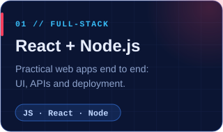
  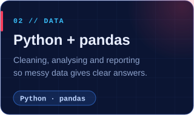
  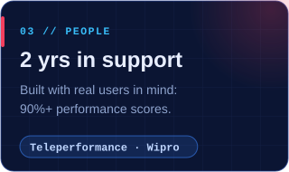

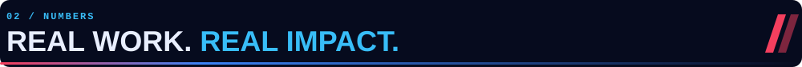

  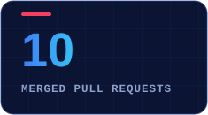
  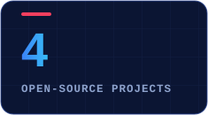
  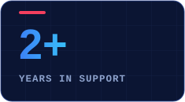
  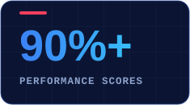

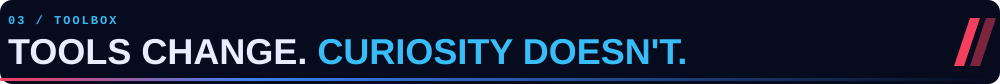

  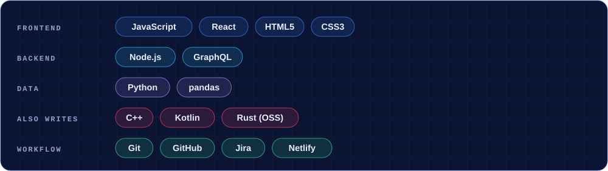

  <a href="https://github.com/kmolan/multicalc-rust/pulls?q=is%3Apr+author%3Anaseem173+is%3Amerged">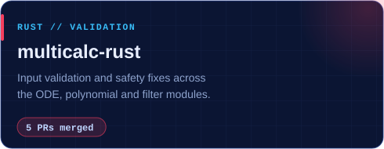</a>
  <a href="https://github.com/posit-dev/great-tables/pull/857">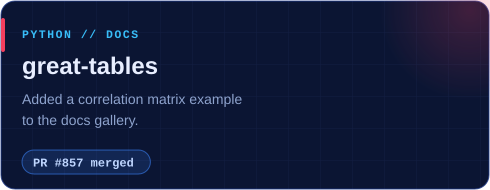</a>
  <a href="https://github.com/FreshCode-Org/freshdata/pulls?q=is%3Apr+author%3Anaseem173+is%3Amerged">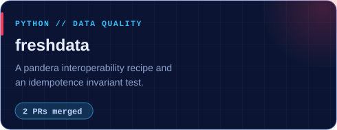</a>
  <a href="https://github.com/ZenEducation/PE_GraphQL_Schemas/pulls?q=is%3Apr+author%3Anaseem173+is%3Amerged">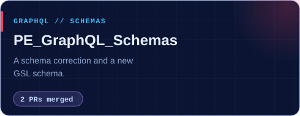</a>

<b>All merged pull requests</b>

 

| Project | Pull requests |
| --- | --- |
| [kmolan/multicalc-rust](https://github.com/kmolan/multicalc-rust) | [#350](https://github.com/kmolan/multicalc-rust/pull/350), [#348](https://github.com/kmolan/multicalc-rust/pull/348), [#331](https://github.com/kmolan/multicalc-rust/pull/331), [#310](https://github.com/kmolan/multicalc-rust/pull/310), [#307](https://github.com/kmolan/multicalc-rust/pull/307) |
| [posit-dev/great-tables](https://github.com/posit-dev/great-tables) | [#857](https://github.com/posit-dev/great-tables/pull/857) |
| [FreshCode-Org/freshdata](https://github.com/FreshCode-Org/freshdata) | [#169](https://github.com/FreshCode-Org/freshdata/pull/169), [#172](https://github.com/FreshCode-Org/freshdata/pull/172) |
| [ZenEducation/PE_GraphQL_Schemas](https://github.com/ZenEducation/PE_GraphQL_Schemas) | [#10](https://github.com/ZenEducation/PE_GraphQL_Schemas/pull/10), [#11](https://github.com/ZenEducation/PE_GraphQL_Schemas/pull/11) |

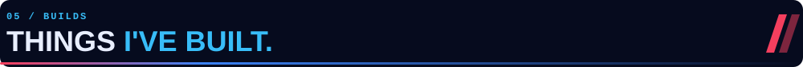

  <a href="https://github.com/naseem173/stock-predictor">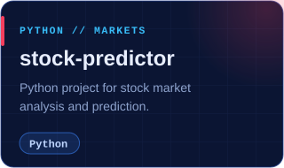</a>
  <a href="https://github.com/naseem173/data-portfolio">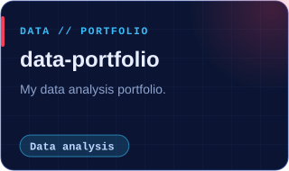</a>
  <a href="https://mohd-naseemuddin.netlify.app">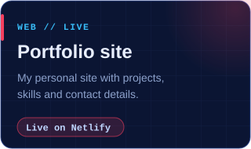</a>

  
  
  <a href="https://mohd-naseemuddin.netlify.app">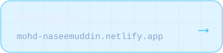</a>

